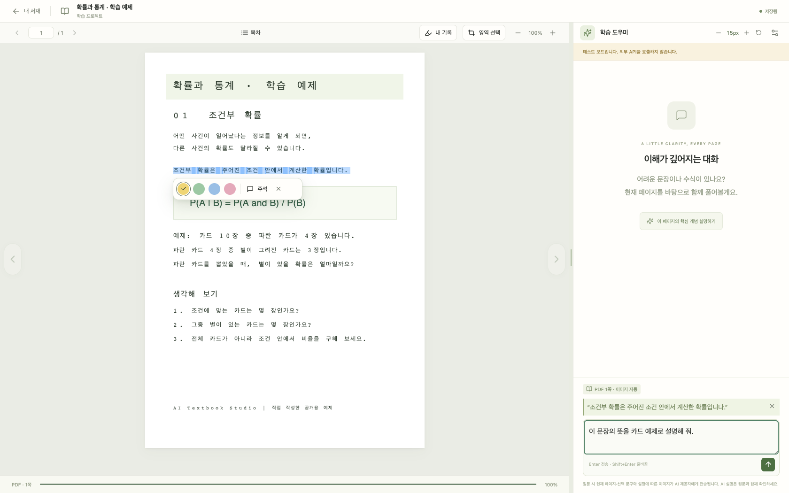
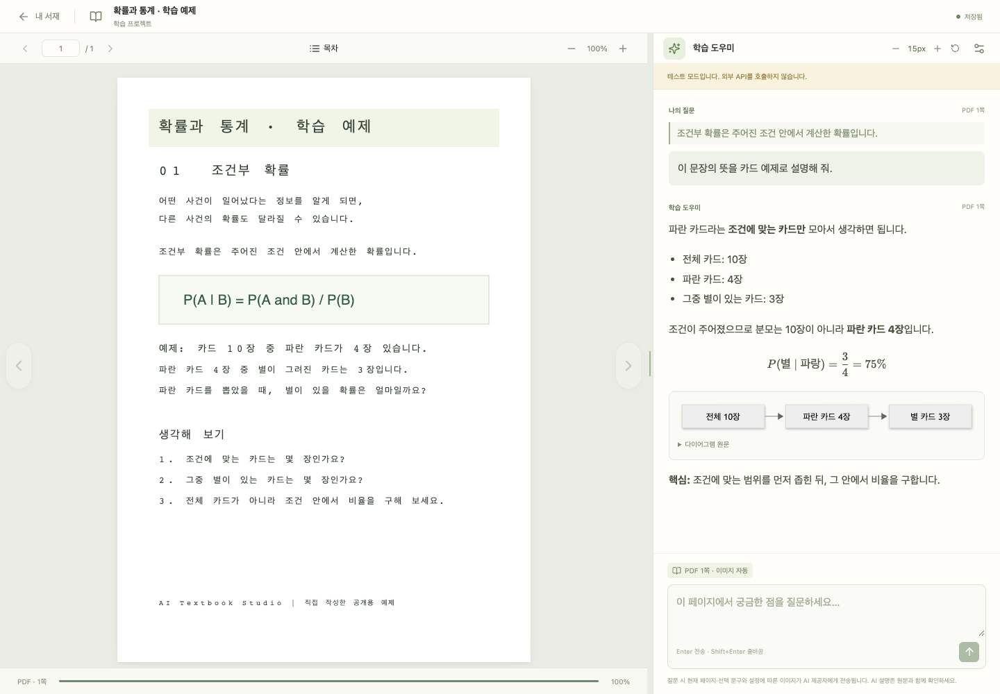

# AI Textbook Studio

PDF 한 권을 하나의 학습 프로젝트로 관리하는 개인용 웹앱입니다. PDF를 읽고 문장을 선택해 질문하며, 같은 서버에 다시 접속하면 독서 위치와 대화를 복원합니다.

현재 구현: PDF 업로드·목록·확인 후 삭제, PDF.js 텍스트 선택·페이지·줌, 독서 상태 저장, 책별 대화, AI 답변 스트리밍, 스캔 페이지 이미지 질문, 실패·중단 기록과 재시도. 내장 목차가 없는 PDF의 목차 페이지 추출을 지원하며, 본문 전체 OCR과 RAG는 후속 범위입니다.

PDF 양옆의 방향 버튼으로 페이지를 넘길 수 있습니다. 학습 도우미와 PDF 사이의 경계선을 드래그하면 도우미 너비가 바뀌고 이 브라우저에 저장됩니다. 경계선을 두 번 클릭하면 기본 너비로 돌아오며 키보드 좌우 방향키도 사용할 수 있습니다. 도우미 헤더의 **−/+** 버튼으로 대화 본문과 질문 입력 글자를 10~24px로 조절하며 이 브라우저에 저장됩니다. 헤더의 **초기화** 아이콘은 글자 크기를 기본값으로 되돌립니다. 모바일에서는 세로 배치를 유지하며 글자 크기를 조절할 수 있습니다.

상단 페이지 이동과 확대/축소 사이의 **목차**를 누르면 PDF에 포함된 북마크 목차가 표시됩니다. 항목을 선택하면 해당 페이지로 이동하고 독서 위치가 저장됩니다. 내장 목차가 없으면 앞 24페이지에서 목차 제목·항목 배치·숫자 정렬·쪽수 증가 패턴을 확인하여 목차를 추출합니다. 이미지 스캔은 한국어·영어 로컬 OCR을 사용하며, 그림·표 목록과 숫자 위주의 본문 표는 제외합니다. 다단 목차와 바로 다음 페이지로 이어지는 목차, 쪽 번호가 붙은 Contents 머리말을 지원합니다. 스캔에 기존 텍스트층이 있어도 쪽수 좌표가 손상된 경우 숫자 열의 점선을 제거하고 로컬 OCR로 다시 읽으며, 빠진 장 제목도 복원합니다. 추출 결과는 서버에 캐시하고, 원본 PDF는 수정하지 않습니다. 첫 인식은 최대 2분 정도 걸릴 수 있습니다.

인쇄 쪽수와 실제 PDF 페이지 차이는 여러 페이지의 하단 쪽수로 확인합니다. 확인할 수 없는 경우 **쪽수 보정 (PDF − 인쇄)**에 값을 입력해야 목차 이동이 활성화됩니다. 예를 들어 PDF 10쪽이 인쇄 1쪽이면 `9`를 입력합니다. 발췌 문서는 음수도 입력할 수 있습니다. 보정값은 책별로 이 브라우저에 저장되며 비우면 자동 보정을 사용합니다. 잘못 읽은 숫자나 복잡한 편집이 의심되면 이동 위치를 확인하세요. 로마 숫자만 있는 항목이나 회전·심하게 손상된 스캔, 제목 없이 시작되는 목차는 자동 인식 대상에서 빠질 수 있습니다. 사이트 아이콘은 화면의 책 아이콘을 재사용합니다.

학습 도우미의 **AI 설정**에서 OpenAI, Claude (Anthropic), Gemini (Google), OpenRouter 중 제공업체를 선택하고 모델 ID를 직접 입력합니다. **연결 테스트**는 설정을 저장하지 않고 책 내용 없이 짧은 실제 스트리밍 요청을 보내 텍스트 응답을 확인합니다. API 사용량이 발생할 수 있으며 이미지 입력 지원까지 보장하지는 않습니다. **설정 저장**을 누르면 선택이 서버에 저장됩니다. 진행 중인 답변과 실패 답변 재시도는 질문 당시 제공업체와 모델을 유지합니다.

API 키는 서버 `.env`의 `OPENAI_API_KEY`, `ANTHROPIC_API_KEY`, `GEMINI_API_KEY`, `OPENROUTER_API_KEY` 중 사용할 업체의 항목에 설정하고 서버를 재시작합니다. 키는 브라우저에 전달하지 않습니다. OpenAI는 기존 Responses API를 사용하며 다른 제공업체는 공식 OpenAI 호환 API로 텍스트·이미지와 스트리밍을 처리합니다 ([Claude](https://platform.claude.com/docs/en/cli-sdks-libraries/libraries/openai-sdk), [Gemini](https://ai.google.dev/gemini-api/docs/openai), [OpenRouter](https://openrouter.ai/developers)).

답변의 `$...$`, `$$...$$`, `\(...\)`, `\[...\]` 수식은 KaTeX로, `mermaid` 코드 블록은 다이어그램으로 표시합니다. 잘못된 다이어그램은 원문을 표시하며 일반 코드 블록은 그대로 보존합니다. 수식 폰트와 다이어그램 코드는 로컬 번들로 제공합니다.

## 활용 예제

아래는 직접 작성한 예제 PDF와 예시 대화로 구성한 데모 화면입니다. 외부 AI를 호출하지 않는 테스트 모드에서 촬영했습니다.

### 문장을 선택해 질문하기

PDF에서 궁금한 문장을 선택하면 질문 입력창 위에 선택 문구가 표시됩니다. 질문을 입력하고 전송하면 현재 페이지와 선택 문구를 바탕으로 설명을 요청합니다.



### 수식과 다이어그램으로 이해하기

PDF를 옆에 두고 설명을 읽으며, 답변에 포함된 수식과 다이어그램을 확인할 수 있습니다. 도우미 헤더의 −/+ 버튼으로 대화와 질문 입력 글자 크기를 조절합니다.



## 설치와 개발 실행

Python 3.13 이상, Node.js 22.16 이상, npm, uv가 필요합니다. 현재 검증 환경은 macOS / Python 3.13.7 / Node 22.16.0입니다.

```sh
make install
```

설치 과정에서 공개 Tesseract `tessdata_fast` 한국어·영어 언어 파일을 `.cache/tessdata`에 받습니다. 기존 설치에는 `make install-ocr`를 한 번 실행합니다. 별도 Tesseract 실행 파일은 필요하지 않으며, 문서 인식은 PyMuPDF 내장 엔진으로 서버 안에서 수행합니다 ([PyMuPDF OCR 문서](https://pymupdf.readthedocs.io/en/latest/page.html#Page.get_textpage_ocr)). OCR 데이터가 없으면 화면에 설치·재시도 안내를 표시합니다. 다른 언어 데이터는 `OCR_TESSDATA` 절대 경로와 `OCR_LANGUAGE`(예: `kor+eng`)로 지정할 수 있습니다. 검색 범위와 처리 시간은 `OUTLINE_MAX_PAGES`(1~100, 기본 24), `OUTLINE_TIMEOUT_SECONDS`(기본 120)로 조정합니다.

`.env.example`을 참고해 저장소 루트에 `.env`를 준비합니다. 기존 `.env`가 있으면 덮어쓰지 말고 필요한 항목만 추가합니다.

```dotenv
OPENAI_API_KEY=your-server-side-api-key
LLM_PROVIDER=openai
LLM_MODEL=gpt-5.4-mini
DATABASE_URL=sqlite:///./data/learning.db
```

모델은 선택한 제공업체 계정에서 사용 가능한 스트리밍 지원 모델로 설정합니다. 스캔 PDF에는 이미지 입력도 지원해야 합니다. 예제 모델의 기능은 [OpenAI 공식 문서](https://developers.openai.com/api/docs/models/gpt-5.4-mini)를 참고하세요. API 키와 모델이 없어도 도서 등록·읽기·위치 저장은 사용할 수 있습니다. 인증 오류가 나면 키를 서버 `.env`에서 수정하고 서버를 재시작합니다.

네 제공업체의 API 키는 프로젝트 `.env`에 항목이 있으면 그 값을 셸의 같은 이름 환경변수보다 우선합니다. 그 밖의 설정은 셸 환경변수가 `.env`보다 우선합니다.

```sh
make dev
```

브라우저에서 **http://127.0.0.1:5173** 에 접속합니다. API는 8000 포트, API 문서는 http://127.0.0.1:8000/docs 입니다. Ctrl+C로 두 프로세스를 함께 종료합니다. DB 마이그레이션은 서버 시작 시 자동 적용합니다. 데이터 경로는 실행 디렉터리와 관계없이 저장소 루트 기준으로 정규화합니다.

외부 AI 호출 없는 개발·테스트 모드:

```sh
LLM_PROVIDER=fake make dev
```

화면에 테스트 모드임을 표시하며 실제 설명을 생성하지 않습니다. 일반 실행과 같은 데이터 경로를 사용하므로 완전히 분리하려면 `DATA_DIR`과 `DATABASE_URL`을 **둘 다** 별도 경로로 설정합니다.

## 단일 서버 실행과 LAN 접속

```sh
make build
make serve
```

빌드된 웹 화면과 API를 모두 **http://127.0.0.1:8000** 에서 제공합니다. 다른 기기도 같은 서버에 접속해야 위치와 이력이 이어집니다.

터미널을 닫아도 계속 실행할 백그라운드 서버는 다음 명령으로 관리합니다.

```sh
make build       # 최초 실행 또는 프론트엔드 변경 후
make up          # 백그라운드 시작
make status      # 실행 상태 확인
make logs        # 로그 보기, Ctrl+C로 로그 보기만 종료
make restart     # 서버 재시작
make down        # 서버 종료
```

`make serve`는 포그라운드 실행이며 위 명령의 관리 대상이 아닙니다. 이미 8000 포트를 사용하는 서버가 있으면 먼저 해당 터미널에서 종료합니다. 관리 스크립트는 자신이 기록한 PID·시작 시각·실행 명령이 일치하는 서버만 종료하며, 포트를 사용하는 다른 프로세스는 종료하지 않습니다. PID 기록과 로그는 Git에서 제외되는 `.cache/servers/`에 저장합니다. 시작 시 DB 준비 상태를 확인하고 중복 실행을 방지합니다. 재부팅 후 자동 실행 기능은 포함하지 않습니다.

포트·주소를 지정하려면 직접 실행합니다. 종료·상태 확인에도 같은 포트를 지정합니다.

```sh
python3 scripts/server.py start --host 127.0.0.1 --port 8001
python3 scripts/server.py status --port 8001
python3 scripts/server.py stop --port 8001
```

신뢰하는 개인 LAN에서는 `.env`의 `ALLOWED_HOSTS`에 서버 IP/호스트명을, `ALLOWED_ORIGINS`에 실제 브라우저 origin을 추가합니다. 예를 들어 서버가 `192.168.0.10`이면 기존 값에 각각 `192.168.0.10`, `http://192.168.0.10:8000`을 추가하고 실행합니다.

```sh
cd backend
.venv/bin/python -m uvicorn app.asgi:app --host 0.0.0.0 --port 8000
```

MVP에는 사용자 인증이 없으며 개인 LAN 사용을 전제로 합니다. 인터넷 공개·공유 서버 운영은 구현 범위에 포함하지 않습니다. 서버 프로세스는 1개로 실행하고 SQLite는 로컬 디스크에 둡니다.

## 검증

```sh
make test
```

백엔드 통합 테스트, SSE 파서 테스트, TypeScript 검사·운영 빌드를 실행합니다. 테스트는 직접 생성한 PDF와 임시 SQLite를 사용하며 실제 API를 호출하지 않습니다.

실제 API 연결은 `make test-live`로 별도 검증합니다. 직접 생성한 텍스트·스캔 PDF로 각각 한 번씩 질문하므로 API 사용량이 발생합니다. 기존 서재를 사용하지 않고 임시 디렉터리를 정리합니다.

Chrome이 설치된 환경에서 브라우저 통합 검증:

```sh
# 터미널 1: 실제 서재와 분리한 테스트 서버
LLM_PROVIDER=fake DATA_DIR=.cache/e2e DATABASE_URL=sqlite:///./.cache/e2e/learning.db make dev
# 터미널 2
cd frontend
npm run test:e2e
```

Firefox 검증은 `cd frontend`에서 `npx playwright install firefox`로 테스트 브라우저를 설치한 뒤 `STUDIO_TEST_BROWSER=firefox npm run test:e2e`로 실행합니다.

PDF 업로드, 127쪽 문구 선택·질문, 저장 실패·복구, 새로고침·두 번째 브라우저 세션에서 복원, 스캔 이미지 질문, 삭제 확인과 모바일 화면을 검증합니다. 브라우저 테스트는 테스트 서버에서만 실행합니다. 성공한 테스트의 책은 삭제하며 실패한 테스트 데이터는 `.cache/e2e`에 남을 수 있습니다.

## 데이터와 설정

- 기본 저장 위치: `data/learning.db`, `data/books/<uuid>/original.pdf`, 페이지 이미지·추출 목차 캐시.
- 업로드 기본 상한: 500 MiB (524,288,000바이트) / 2,000페이지. `MAX_UPLOAD_BYTES`로 파일 크기 상한을 변경할 수 있습니다. 손상·암호화 PDF는 거절합니다.
- 현재 페이지는 PDF 물리 페이지 번호이며 1부터 시작합니다. 인쇄된 쪽 번호와 다를 수 있습니다.
- 상태는 500ms debounce로 저장하며 실패하면 화면에 재시도를 표시합니다. 여러 기기 동시 사용은 서버가 마지막으로 받은 저장을 채택합니다.
- 이미지 자동 모드는 텍스트가 부족한 페이지에 이미지를 첨부합니다. 텍스트가 있는 수식·도표는 AI 설정에서 ‘항상 첨부’를 선택합니다.
- 요청이 중단되면 부분 답변·질문을 보존합니다. 재시도는 새로운 API 호출이므로 사용량이 추가됩니다.
- 책·추출 문맥·학습 기록·`.env`는 Git에 포함하지 않습니다. 목차 인식은 외부 AI를 호출하지 않습니다. 질문할 때 표시된 문맥과 설정에 따른 페이지 이미지만 외부 LLM으로 전송합니다. API 키는 서버에서만 사용합니다.
- 서재 상단 **설정** 또는 독서 화면 **AI 설정 → 학습 데이터 백업**에서 서버 컴퓨터의 백업 경로를 입력하고 **지금 백업**을 누릅니다. 사용법과 복구 절차는 아래를 참고하세요.
- PDF 엔진 PyMuPDF의 라이선스는 [공식 안내](https://pymupdf.readthedocs.io/en/latest/about.html#license-and-copyright)를 확인하세요. 저장소 자체의 공개 배포 라이선스는 아직 정하지 않았습니다.

## 학습 데이터 백업과 복구

서재 상단의 **설정** 또는 독서 화면의 **AI 설정 → 학습 데이터 백업**에서 백업 폴더의 **절대 경로**를 입력합니다. 예: `/Volumes/StudyDrive/textbook-backups`. 경로는 브라우저가 아니라 **서버를 실행하는 컴퓨터 기준**이며 현재 데이터 폴더 밖이어야 합니다. **백업 설정 저장**으로 경로와 자동 백업 사용 여부를 저장합니다. 자동 백업은 기본으로 켜져 있으며, 경로 설정 후 1분 안에 첫 확인을 시작하고 이후 30분마다 변경 사항이 있을 때만 백업합니다. **지금 백업**으로 즉시 수동 백업할 수도 있습니다. 없는 폴더는 생성하며 쓰기 권한과 충분한 공간이 필요합니다. 외장 디스크는 연결·마운트 상태를 먼저 확인하세요.

매번 `textbook-studio-시간-고유번호` 폴더를 새로 생성합니다. 새 백업이 성공하면 현재 경로에서 이 앱이 관리하는 최신 백업 10개를 유지합니다. 수동·자동 백업 모두 포함되며, 자동 백업 도입 전의 백업이나 다른 설치본의 백업·일반 폴더는 자동 삭제하지 않습니다. 원본 PDF, 모든 책의 대화·독서 위치, 서버 앱 설정, 복구 안내를 포함합니다. SQLite의 실행 중 백업 기능으로 WAL에 저장된 내용과 별도 경로에 둔 DB도 포함합니다. PDF 복사 중 책 삭제를 막고, PDF 체크섬과 DB 무결성을 검사한 뒤 최종 폴더를 표시합니다. 실패한 작업의 임시 폴더는 정리합니다. 갑작스러운 서버 종료로 남은 `.textbook-backup-` 임시 폴더는 완성된 백업이 아니므로 복구에 사용하지 마세요.

백업 시점에 서버에 저장된 내용까지 포함합니다. 질문 답변을 끝내고 독서 위치가 저장된 뒤 실행하면 최신 기록을 보관할 수 있습니다. 진행 중이던 답변은 복구 시 중단 상태로 표시됩니다. API 키·`.env`, 브라우저에 저장된 글자 크기·패널 너비, 재생성 가능한 페이지 이미지 캐시는 포함하지 않습니다. 자동 백업은 서버에서 동작하므로 브라우저를 닫아도 계속되지만, 서버나 컴퓨터가 꺼져 있는 동안에는 실행되지 않습니다. 서버를 다시 켜면 마지막 확인 시각을 기준으로 기한이 지난 작업을 확인합니다. 단순 열람 시각·같은 위치의 중복 저장·백업 상태 갱신은 변경 사항으로 세지 않습니다. 마지막 성공 시각·백업 경로·실패 상태는 설정 화면에서 확인합니다. 실패 시 기존 백업을 보존하고 30분 뒤 다시 시도합니다. 오래된 백업 정리만 실패한 경우에도 새 백업은 보존하고 상태에 표시합니다. 컴퓨터 고장에 대비하려면 외장 디스크나 다른 장치로 동기화되는 폴더를 지정하세요.

복구할 때는 원본 백업을 보존하고 **완성된 백업 폴더 전체의 복사본**을 로컬 디스크에 둡니다. 같은 앱 버전 또는 호환되는 새 버전에서 서버를 종료한 뒤 프로젝트 `.env`의 **두 경로를 모두** 수정합니다.

```dotenv
DATA_DIR=/Users/me/restored-study
DATABASE_URL=sqlite:////Users/me/restored-study/learning.db
```

`restored-study` 안에 `learning.db`와 `books/`가 있어야 합니다. 필요한 제공업체 API 키를 다시 설정하고 서버를 시작한 뒤 서재와 대화를 확인하세요. 기존 데이터는 덮어쓰지 않으며, 원래 경로를 다시 지정하면 원래 서재로 돌아갑니다. SQLite 데이터는 동기화 중인 네트워크 폴더에서 직접 실행하지 말고 로컬 디스크로 복사해 사용하세요.

## 설계와 진행 상태

[제품 요구사항](docs/PRD.md) · [구현 계획](docs/IMPLEMENTATION_PLAN.md) · [구현·검증 현황](docs/IMPLEMENTATION_STATUS.md)
